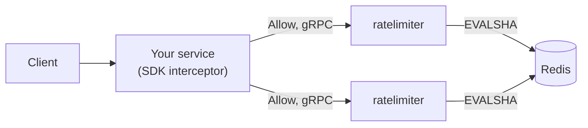

# distributed-rate-limiter


Distributed rate limiting as a gRPC microservice, in Go, backed by Redis and Lua.
A Go SDK plugs it into a gRPC server or a `net/http` handler. A demo instance
runs on Cloud Run, see [Deploy](#deploy).

## Problem

A counter kept inside each instance cannot enforce a global limit: with three
replicas, a key gets three times its limit. The count has to live in one shared
store, and reading, deciding and writing must be one atomic step, or two
concurrent requests can both take the last unit.

## Features

- **Exact under concurrency.** Each decision is one Lua script in Redis. 2000
  requests from 200 goroutines over two Redis clients, limit 500: exactly 500
  allowed ([test](test/load/accuracy_test.go)).
- **One limit across replicas.** 1000 calls through two limiter servers sharing
  one Redis allow exactly the limit ([test](test/e2e/e2e_test.go)).
- **Two algorithms**, both O(1) memory per key: token bucket and sliding window
  counter ([code](internal/limiter/)).
- **`Peek` changes nothing.** The read-only script runs with the `no-writes`
  flag, and a property test checks that `Peek` always equals the `Allow` that
  follows it ([test](internal/limiter/peek_test.go)).
- **Redis outage is not a crash.** `Allow` returns `Unavailable` after
  `REDIS_TIMEOUT`, the process and its health stay up
  ([chaos run](docs/chaos.md)).
- **Policies reload on `SIGHUP`.** A broken file keeps the old policies
  ([test](cmd/ratelimiter/reload_test.go)).
- **Go SDK** with a gRPC server interceptor and HTTP middleware, and a fail mode
  the caller must choose ([tests](pkg/client/behaviour_test.go)).
- **Observable.** Prometheus metrics, gRPC health and reflection, JSON logs that
  Cloud Logging reads ([test](internal/server/server_test.go)).

## Architecture



How one `Allow` runs:

1. The SDK takes the key from the request (header, metadata or peer IP) and calls
   `Allow` with its namespace and the method's policy, within 100 ms.
2. The service validates the request, reads the policy from an immutable
   in-memory snapshot and takes the current time.
3. The limiter builds the key `rl:{namespace:policy:key}:tb` and runs the Lua
   script with the time as an argument, within `REDIS_TIMEOUT`.
4. The script reads the state, decides, writes only if allowed, sets a TTL and
   returns integers.
5. A decision is `OK` with `allowed` true or false. The SDK turns a denial into
   `ResourceExhausted` or HTTP 429, and `Unavailable` into its fail mode.

More in [docs/architecture.md](docs/architecture.md).

## Quickstart

Two limiter replicas sharing one Redis, and a demo service (`greeter`) protected
by the SDK. Needs Docker and [grpcurl](https://github.com/fullstorydev/grpcurl).

```bash
git clone https://github.com/asmanya/distributed-rate-limiter
cd distributed-rate-limiter
docker compose --profile demo up -d --build --wait
```

```bash
grpcurl -plaintext localhost:50051 list

# warm-up with another key, see the note below
grpcurl -plaintext -H 'x-api-key: warmup' -d '{"name":"world"}' \
  localhost:50051 examples.greeter.v1.GreeterService/SayHello
sleep 1

for i in $(seq 1 10); do
  grpcurl -plaintext -H 'x-api-key: demo' -d '{"name":"world"}' \
    localhost:50051 examples.greeter.v1.GreeterService/SayHello
done

docker compose --profile demo logs ratelimiter | grep '"message":"rpc"'
```

The greeter allows 5 calls per 10 seconds per API key. The first five return
`{"message": "Hello, world!"}`, the rest `ResourceExhausted` with a `RetryInfo`
detail. The demo logs every call, prefixed with the replica that served it.

Why the warm-up: the greeter fails open and gives the limiter 100 ms per call.
Right after it starts, its connection to the limiter is not open yet, so one of
the first calls can time out and pass without being counted (the greeter logs
`failing open`). Without the warm-up, more than five of the ten calls can
succeed.

Stop it with `docker compose --profile demo down` (`make down` stops only Redis).

### The limiter on its own

Needs Go 1.27, Docker and grpcurl.

```bash
make up    # Redis 8 in Docker
make run   # gRPC on :8080, metrics on :9090; reads .env if present

grpcurl -plaintext -d '{"namespace":"demo","policy":"login","key":"user-1"}' \
  localhost:8080 ratelimiter.v1.RateLimitService/Allow
```

`login` allows 5 per 10 seconds. The sixth call returns no `allowed` field
(grpcurl omits `false`) and a `retryAfter`.

## SDK usage

[`pkg/client`](pkg/client/) runs on the server side of the service being
protected. From [`examples/greeter`](examples/greeter/main.go):

```go
limiter, err := client.New("dns:///localhost:8080",
	client.WithNamespace("greeter"),
	client.WithFailMode(client.FailOpen),
	client.WithTransportCredentials(insecure.NewCredentials()), // TLS in production
)
if err != nil {
	return err
}
defer limiter.Close()

limits := map[string]string{greeterv1.GreeterService_SayHello_FullMethodName: "greeter"}
srv := grpc.NewServer(grpc.UnaryInterceptor(
	limiter.UnaryServerInterceptor(limits, client.KeyFromMetadata("x-api-key"))))
```

For HTTP: `limiter.HTTPMiddleware("search", client.KeyFromHeader("X-API-Key"))(handler)`.

- Namespace, fail mode and credentials have no defaults: failing open and running
  without TLS are explicit choices.
- Keys come from `KeyFromMetadata`, `KeyFromHeader` or `KeyFromPeer`. A missing
  value falls back to the caller's IP. A key the service would reject is hashed,
  so a malformed key cannot bypass the limit.
- Denied: `ResourceExhausted` with `RetryInfo`, or HTTP 429 with `Retry-After`.
  Limiter unreachable: `FailOpen` lets the request through, `FailClosed` returns
  `Unavailable` or HTTP 503.
- Each call has a 100 ms timeout (`WithTimeout`). Keep it above the service's
  `REDIS_TIMEOUT` plus the network.
- Behind a proxy, `KeyFromPeer` sees the proxy. Use `KeyFromHeader` with a header
  the proxy sets.

## Algorithms

| | Token bucket | Sliding window counter |
| --- | --- | --- |
| State | One hash: tokens left, last update | Two counters: this window and the previous one |
| Behaviour | Bursts up to `limit`, refills at `limit` per `period` | At most `limit` per window, previous window weighted in |
| Accuracy | Exact | Approximate: assumes the previous window was evenly spread |
| Use for | APIs that tolerate bursts | Strict quotas, e.g. 5 logins per 10 seconds |

Both pass the [accuracy test](test/load/accuracy_test.go). The sliding window
prevents the fixed-window double burst at a boundary
([test](internal/limiter/slidingwindow_test.go)).

## Design decisions

- [ADR 0001](docs/adr/0001-lua-atomicity.md): every decision is one Lua script.
  No `INCR` + `EXPIRE`, no `WATCH`/`MULTI`: one atomic step, one round trip.
- [ADR 0002](docs/adr/0002-time-source.md): the caller supplies the time. Scripts
  never call `TIME`, so they are deterministic and tests control the clock.
- [ADR 0003](docs/adr/0003-fail-mode-in-caller.md): failing open or closed is the
  caller's choice. The service only reports `Unavailable`.

## Failure modes

| Failure | What happens | Proof |
| --- | --- | --- |
| Redis slow, paused or down | `Unavailable` after `REDIS_TIMEOUT` (about 51 ms measured with 50 ms). Process and health stay up; requests succeed again when Redis returns, no restart | [chaos.md](docs/chaos.md) |
| Limiter down or slow | The SDK applies the caller's fail mode within its timeout | [SDK tests](pkg/client/behaviour_test.go) |
| Clock skew between replicas | A negative elapsed time is clamped to zero: no refill backwards, no crash. Skew of milliseconds against windows of seconds is negligible | [test](internal/limiter/tokenbucket_test.go), [ADR 0002](docs/adr/0002-time-source.md) |
| Hot key | One Redis runs every script on one thread, so one hot key is no slower than many keys. On a Redis Cluster it would sit on one shard | [benchmarks](docs/benchmarks.md) |
| `SIGTERM` | Health goes `NOT_SERVING`, in-flight requests finish, exit 0 | [chaos.md](docs/chaos.md) |

A denied request is not a failure: it is `OK` with `allowed=false`. Health never
depends on Redis, so a Redis outage does not make the platform restart replicas.

## Benchmarks

Median of 3 runs of 30 s with `ghz`, token bucket, Redis 8 in Docker, all on one
AMD Ryzen 5 5600H laptop in WSL2.

| Scenario | RPS | p50 | p99 |
| --- | --- | --- | --- |
| 10,000 keys, 10 clients | 7,623 | 1.08 ms | 2.05 ms |
| 10,000 keys, 100 clients | 18,696 | 4.41 ms | 9.76 ms |
| One hot key, 100 clients | 20,140 | 4.21 ms | 9.30 ms |

The ceiling is the Redis round trip: at 100 clients Redis was at 89 to 93 % of
one core (one sample per run), and a CPU profile showed no hot spot in the
service's own code.
Method, raw output and analysis: [docs/benchmarks.md](docs/benchmarks.md).

## Deploy

The demo runs on Cloud Run (`asia-south1`) with Upstash as the Redis.

```bash
grpcurl ratelimiter-748792177625.asia-south1.run.app:443 list
```

It may be throttled or offline. It has no authentication, `AdminService` is off
and it is capped at 2 instances. TLS ends at the Cloud Run edge; the container
serves HTTP/2 without TLS (h2c), hence `--use-http2`.

Measured on it: an `Allow` takes 4.7 to 9.4 ms inside the service (6 calls, Cloud
Run request logs). A cold start adds about 0.77 s (1.014 s against 0.244 s for
`grpcurl list` from a laptop, one measurement).

`make deploy` builds the last `Dockerfile` stage (distroless, non-root, 37.4 MB
locally) with Cloud Build and deploys it with:

| Setting | Value |
| --- | --- |
| `REDIS_URL` | from Secret Manager (`redis-url`), never a plain env var |
| `REDIS_TIMEOUT` | 200 ms, a starting value; generous against the measured 4.7 to 9.4 ms |
| `SHUTDOWN_TIMEOUT` | 8 s, inside Cloud Run's 10 s between `SIGTERM` and `SIGKILL` |
| `ADMIN_ENABLED` | `false` |
| Instances | min 0, max 2 |
| Startup probe | gRPC health, set once (below); `make deploy` keeps it |

One-time setup, with `gcloud` logged in and `REDIS_URL` in the shell
(`set -a; . ./.env; set +a`):

```bash
gcloud config set project PROJECT_ID
gcloud services enable run.googleapis.com cloudbuild.googleapis.com \
  artifactregistry.googleapis.com secretmanager.googleapis.com

# stdin keeps the URL out of shell history; printf adds no trailing newline
printf %s "$REDIS_URL" | gcloud secrets create redis-url --data-file=-

gcloud iam service-accounts create ratelimiter-run
gcloud secrets add-iam-policy-binding redis-url \
  --member=serviceAccount:ratelimiter-run@PROJECT_ID.iam.gserviceaccount.com \
  --role=roles/secretmanager.secretAccessor

# Cloud Build runs as the default compute account; without this the first deploy gets a 403
gcloud projects add-iam-policy-binding PROJECT_ID \
  --member=serviceAccount:PROJECT_NUMBER-compute@developer.gserviceaccount.com \
  --role=roles/cloudbuild.builds.builder

make deploy

gcloud run services update ratelimiter --region asia-south1 \
  --startup-probe=grpc.port=8080,periodSeconds=5,timeoutSeconds=2,failureThreshold=6
```

Cloud Run exposes one port, so `/metrics` is not reachable there; use Cloud
Logging. Upstash's free tier allows 500K commands a month: run the integration
suite against it once, not in a loop.

## Limitations and future work

- **One Redis.** No Cluster or Sentinel failover. If Redis is down, every
  decision is `Unavailable` and callers fall back to their fail mode.
- **No auth or mTLS** between the SDK and the service. The demo endpoint is
  public.
- **Every decision is a Redis round trip.** No local in-memory cache or token
  pre-fetch, which would trade accuracy for latency.
- **A hot key cannot be split.** On a Redis Cluster one key stays on one shard.
- **Only unary RPCs** are limited; streaming RPCs pass through.
- **No tracing** (OpenTelemetry), no dashboard, no multi-region.
- **Deploy is manual** (`make deploy`); there is no CD pipeline.
- Not built: Envoy rate limit service adapter, Kubernetes manifests, other
  storage backends.

## Reference

### API

Contracts are in [`api/ratelimiter/v1/`](api/ratelimiter/v1/). Server reflection
is on.

| RPC | What it does |
| --- | --- |
| `RateLimitService.Allow` | Decides, and if allowed, takes `cost` units from the key |
| `RateLimitService.Peek` | The decision `Allow` would make, without changing anything |
| `AdminService.Reset` | Clears one key's state. Only with `ADMIN_ENABLED=true`; never expose it |

A request has `namespace`, `policy`, `key` and `cost` (0 means 1). The response
has `allowed`, `limit`, `remaining`, `retry_after` and `reset_after`. Namespace
and policy must be non-empty with no `:`, `{` or `}`; the key 1 to 256 bytes with
no `{` or `}`.

| Situation | Code |
| --- | --- |
| A decision was made, allowed or not | `OK` |
| Bad name or key, negative cost, cost above the limit | `InvalidArgument` |
| Unknown policy | `NotFound` |
| Redis error or timeout | `Unavailable` |
| The caller's deadline passed, or it cancelled | `DeadlineExceeded`, `Canceled` |
| A panic in the handler | `Internal` |

### Configuration

Environment variables only; invalid values stop startup with every problem
listed. Template: [`.env.example`](.env.example).

| Variable | Default | Notes |
| --- | --- | --- |
| `PORT` | `8080` | gRPC |
| `METRICS_PORT` | `9090` | HTTP `/metrics`; must differ from `PORT` |
| `REDIS_URL` | `redis://localhost:6379/0` | `rediss://` for TLS; only the host is logged |
| `REDIS_TIMEOUT` | `50ms` | Per Redis call, 1ms to 1s |
| `POLICY_FILE` | `deploy/policies.yaml` | |
| `ADMIN_ENABLED` | `false` | Registers `AdminService` |
| `PPROF_ENABLED` | `false` | `/debug/pprof/` on `METRICS_PORT`; not for production |
| `LOG_LEVEL` | `info` | `debug`, `info`, `warn` or `error` |
| `SHUTDOWN_TIMEOUT` | `10s` | Time for in-flight requests after `SIGTERM` |

Policies are YAML; unknown fields are rejected:

```yaml
policies:
  - name: search
    algorithm: token_bucket    # or sliding_window
    limit: 100
    period: 1m
```

### Observability

| Metric | Type | Labels |
| --- | --- | --- |
| `grpc_server_handled_total` | counter | `method`, `code` |
| `grpc_server_handling_seconds` | histogram | `method` |
| `ratelimiter_decisions_total` | counter | `policy`, `result` |
| `ratelimiter_redis_duration_seconds` | histogram | `script` |
| `ratelimiter_redis_errors_total` | counter | `script` |
| `ratelimiter_policy_reloads_total` | counter | `result` |

No label holds a request key, user id or IP. Logs are JSON on stderr, one line
per failed RPC (successful ones at debug); request keys are never logged.

### Development

| Command | |
| --- | --- |
| `make tools` | Install the proto plugins pinned in `go.mod` |
| `make proto` | Lint the `.proto` files and regenerate `gen/`; needs `buf` |
| `make lint` | `golangci-lint` and `buf lint`; needs both installed |
| `make test` | Unit tests, `-race` |
| `make test-integration` | Integration tests; needs `make up` and `REDIS_URL` exported, or they skip |
| `make load` | The benchmark matrix, about 15 minutes, local Redis only; needs `ghz` |
| `make deploy` | Build and deploy to Cloud Run |

## License

[MIT](LICENSE)
