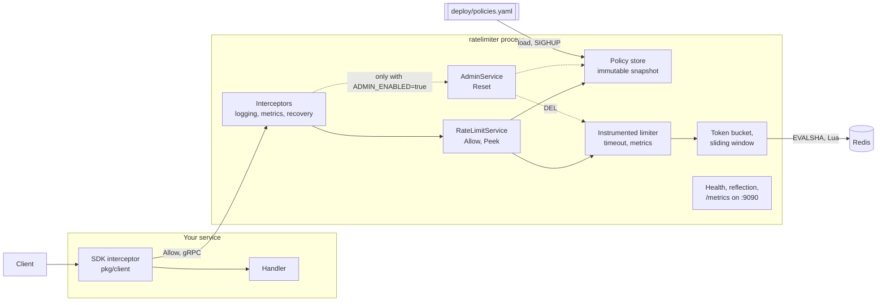

# Architecture

One process, `ratelimiter`, answers gRPC calls and keeps no state of its own:
every counter lives in Redis, so any number of replicas can serve the same keys.

## Components



The dashed path exists only when `ADMIN_ENABLED=true`. Health never touches
Redis, so a Redis outage does not make the platform restart the process.

## Request flow: `Allow`

1. The SDK resolves the key (header, metadata or peer IP; a key the service
   would reject is hashed) and calls `Allow` with its namespace and the method's
   policy, under a 100 ms timeout.
2. The interceptors run outermost first: logging, metrics, recovery. Recovery is
   innermost, so a panic still reaches logging and metrics as `Internal`.
3. `RateLimitService` looks the policy up in the store, an immutable snapshot
   behind an `atomic.Pointer` that `SIGHUP` swaps. An unknown policy is
   `NotFound`, a negative cost `InvalidArgument`, and a cost of 0 becomes 1.
4. It builds a `limiter.Request` with the policy's limit and period and the time
   from its injected clock. The limiter never reads a clock itself.
5. `Instrumented` bounds the call with `REDIS_TIMEOUT` and records
   `ratelimiter_redis_duration_seconds`. Its own timeout becomes
   `Unavailable`; the caller's deadline stays `DeadlineExceeded`.
6. The algorithm validates the namespace, policy and key, builds the keys
   (`rl:{namespace:policy:key}:tb`, or `:sw:<window>` twice for the sliding
   window) and runs its embedded Lua script with `EVALSHA`, falling back to
   `EVAL` when Redis does not have it cached.
7. The script reads the state, refills or weights it, decides, writes only when
   the request is allowed, sets the TTL and returns integers.
8. The service counts the decision in `ratelimiter_decisions_total` and returns
   `OK` with `allowed` true or false. Errors map to `InvalidArgument`,
   `Unavailable` (generic message, details only in the logs) or `Internal`.

`Peek` takes the same path with a read-only script (`no-writes` flag) and is not
counted. `Reset` looks the policy up and deletes the key, bounded by the same
timeout.

## Packages

| Package | Role | Imports from this module |
| --- | --- | --- |
| `cmd/ratelimiter` | Wiring only: config, Redis client, policies, limiters, server, signals | config, limiter, metrics, policy, server, service |
| `internal/server` | gRPC server, interceptors, health, reflection, metrics HTTP | gen, metrics, server/interceptors |
| `internal/service` | gRPC handlers, limiter errors to status codes | gen, limiter, metrics, policy |
| `internal/limiter` | The algorithms, keys and Lua scripts | metrics |
| `internal/policy` | Strict YAML to an immutable snapshot, atomic swap | none |
| `internal/config` | Environment variables to a validated `Config` | none |
| `internal/metrics` | Prometheus collectors on the service's own registry | none |
| `pkg/client` | The public SDK | gen |

Dependencies point strictly downward. `internal/limiter` knows nothing of gRPC,
the service or the configuration: a request carries everything it needs.
`internal/server` does not import the service either; `cmd` hands it the
handlers as generated gRPC interfaces. `pkg/client` imports only the generated
code, never `internal/`. To check:

```bash
go list -f '{{.ImportPath}}: {{join .Imports " "}}' ./... | grep distributed-rate-limiter/
```
